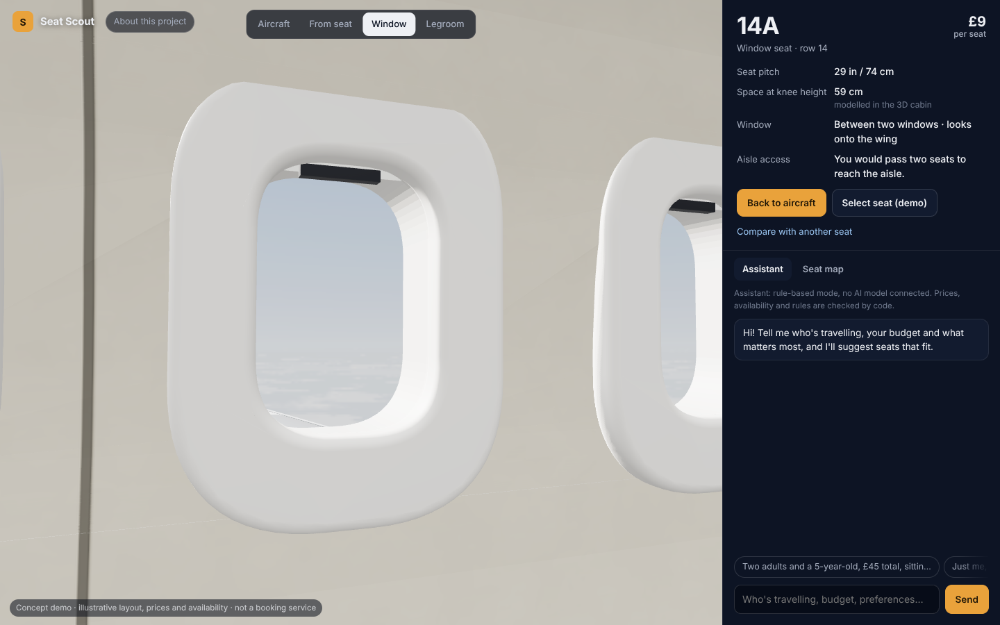
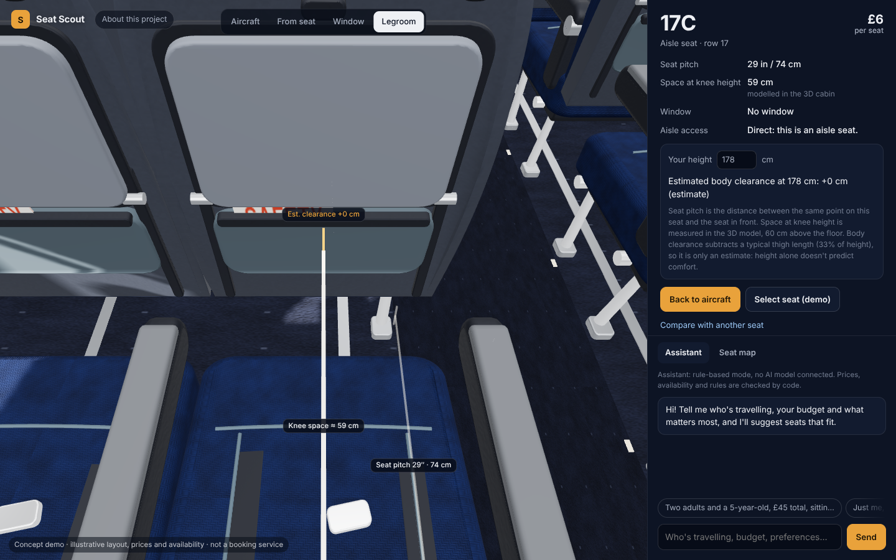
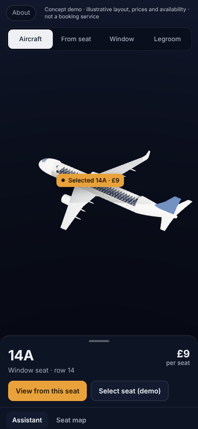
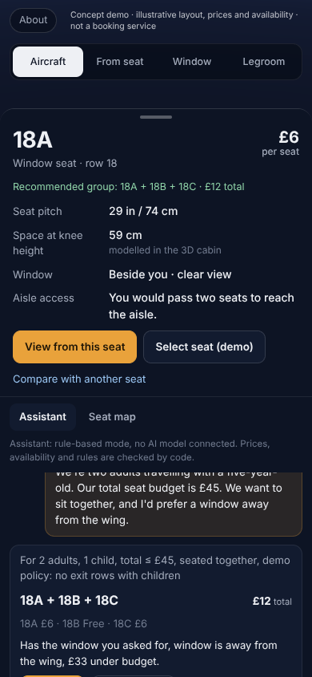

# Seat Scout

**Seat Scout is an independent concept demo exploring how airlines could improve customer service with AI-assisted seat selection and interactive cabin previews. It helps passengers understand seat options and trade-offs before choosing.**


> **Please note**
> - This is a personal portfolio prototype, not a real airline service.
> - It is not affiliated with any airline.
> - The cabin layout, prices and availability are illustrative demo data.
> - It does not make bookings or connect to live airline systems.
> - It was built by Mohammed Banabilh with AI assistance (see [AI-assisted development](#ai-assisted-development)).

**Preview:** a single-file build runs as a [claude.ai artifact](https://claude.ai/artifact/FaweTYWuRkYkGMVkpSTvRa). The artifact is private until I share it, so the link may not open for everyone.

## Run it locally
Requires Node 20+.
```bash
npm install
npm run dev            # builds the page and starts http://localhost:8787 (rule-based mode, no key needed)
```
Optional, for the live AI assistant (the key stays on the server):
```bash
ANTHROPIC_API_KEY=... npm start     # optionally SEAT_SCOUT_MODEL=<model id>
```

## What you can do
1. **Choose a seat** in the 3D aircraft or on the seat map. Taken seats can't be chosen.
2. **See it from the seat**: the forward view, the window view and a legroom view with the modelled space at knee height.
3. **Read the key details**: price, seat pitch, window position and aisle access in plain words ("You would pass two seats to reach the aisle.").
4. **Ask the assistant** about who is travelling, your budget and what matters to you, for example:
   > We're two adults travelling with a five-year-old. Our total seat budget is £45. We want to sit together, and I'd prefer a window away from the wing.

   It answers with one best recommendation, its price and a short reason, plus a **View seat** button. Alternatives and the detailed reasoning are folded away. If you change your requirements ("Actually, £25 maximum."), earlier recommendations are marked **outdated** and can no longer be selected. **Select (demo)** re-checks the seats against current availability; nothing is booked.

Comparison of two seats is available from the seat panel as a small table. Traces, evaluation results, failure-recovery demos and architecture notes are in **About this project**.

| | |
|---|---|
|  |  |
|  |  |

Screenshots were rendered with software WebGL in a headless browser. The 3D cabin and scenery are simplified procedural models, not photorealistic.

## Live AI vs the rule-based fallback
The assistant runs in one of two modes, and the app always says which:

- **Live AI** (when `ANTHROPIC_API_KEY` is set on the server): Claude interprets the request, calls tools and writes the explanation.
- **Rule-based fallback** (no key, or if the model fails): a deterministic parser for common English and Arabic phrasings drives the same tools. It is labelled "rule-based mode, no AI model connected".

In both modes, prices, availability, sitting together and the demo eligibility rules are computed and checked by ordinary code, and every recommendation is re-validated before it is shown or selected. In the claude.ai preview, the same core runs in the page and Claude is reached through the viewer's own claude.ai account when they allow it; otherwise the rule-based mode answers.

---

## How it works
See [docs/architecture.md](docs/architecture.md) for the diagram and trust boundaries.

- **One dataset** (`data/`, generated reproducibly by `scripts/generate-data.ts`) feeds the 3D cabin, seat map, tools and cards. Each attribute is marked synthetic, estimated or calculated.
- **Deterministic core** (`src/core/`): group enumeration, hard constraints with explicit exclusion reasons, transparent scoring, relaxation analysis when nothing fits, an independent validator and grounded explanations.
- **Agent** (`src/agent/`): one bounded tool-use loop (at most 8 steps, model and tool timeouts) with zod-validated tools. The model never computes prices, eligibility or adjacency; cards are built from data, not model text.
- **State** (`src/core/state.ts`): structured trip requirements kept separately from the conversation, so follow-ups change only what you mention; versioned availability snapshots per session.
- **Server** (`src/server/`): Node HTTP with HttpOnly session cookies, per-session rate limits, body validation, and the API key kept server-side. Turns stream their real trace events as NDJSON (the progress shown while waiting). One turn runs at a time per session, and a retry reuses its request id so a turn is never applied twice.
- **Front end** (`web/`): `cabin3d.js` (aircraft, instanced cabin, camera), `scenery.js` (sky and clouds, loaded after the first frame), `flat.js` (2D fallback without WebGL), `ui.js` (seat panel, assistant, About dialog). Render quality drops automatically if frames stay slow.

### Trade-offs
- *Model interprets, code decides:* less flexibility, verifiable correctness.
- *Structured state over chat history:* follow-ups can't silently drop requirements.
- *Re-validate at the end:* handles seats disappearing mid-conversation.
- *Deterministic fallback:* always answers, with narrower language understanding.
- *Procedural 3D:* lightweight and licence-free, not photoreal.

## Evaluation
47 cases in `eval/cases.json`, checked by `eval/checks.ts` against the raw data files (not the engine): strict budgets, adjacent groups, window/aisle, unavailable seats, no feasible solution, multi-turn changes, ambiguous requests, eligibility rules, Arabic and English, and override attempts.

**Deterministic run** (rule-based parser + tools; no model involved):

| Metric | Tool-grounded pipeline | Naive baseline (same parser, no constraint engine) |
|---|---|---|
| Cases passed | 47/47 | 9/47 |
| Request understanding (stated requirements recorded) | 27/27 | 27/27 |
| Parsed-constraint satisfaction (shown groups) | 95/95 | 13/47 |
| Actual-requirement satisfaction (shown groups) | 95/95 | 13/47 |
| Impossible requests recognised | 6/6 | 0/6 |
| Adjacency & price correct (shown groups) | 95/95 | 17/47 |
| Multi-turn state (fields) | 16/16 | 16/16 |
| Unsupported numeric claims | 0 | 0 |

An earlier version recommended free middle seats for "1 adult, window, total £2" and the Arabic "alone, window seat, £3", because a bare "window" was stored as a preference. A named seat position is now a requirement unless the clause softens it ("prefer", "ideally", "نفضل"). History: [eval/results/HISTORY.md](eval/results/HISTORY.md).

**Live-model evaluation has not been run** (no API key was available). `npm run eval:live` would compare the tool-grounded agent with a no-tools baseline; no live-model numbers are claimed.

## Tests
```bash
npm test                 # unit + integration
npm run eval             # deterministic evaluation → eval/results/
npm run test:e2e         # Playwright end-to-end (slow with software WebGL)
npm run build:artifact   # single-file preview → artifact/
node scripts/shots.mjs docs/screenshots   # screenshots (dev tool)
```
The end-to-end tests cover seat selection, the three seat views, key details, recommendations, a budget change with outdated marking, family seating, impossible requests, the two previously failing evaluation cases, availability changes, tool-timeout recovery, demo selection, duplicate submissions and retry, camera interruption, reduced motion, the mobile bottom sheet and the no-WebGL fallback. Latest results: [docs/verification.md](docs/verification.md).

## Known limitations
- Illustrative A320neo-style layout, sample prices and generated availability. Real cabins vary by airline.
- Space at knee height and window position come from a simplified 3D model; body clearance is an estimate, and height alone doesn't predict comfort.
- The exit-row rules are an explicit demo policy (`data/policy.demo.json`), not any airline's.
- The rule-based fallback handles common English and Arabic phrasings only. Groups larger than three, or split seating, aren't supported.
- Performance was only observed with software rendering in a headless container. No frame-rate figure for real hardware is claimed.
- Mobile layout was checked in a 390 × 844 headless viewport, not on physical phones.

## AI-assisted development
**I created Seat Scout with AI coding assistance.** I chose the problem (inspired by a cinema seat-picker demo), wrote the requirement briefs that set the product direction and quality bar, and reviewed the results, asking for changes — including this simplification. I used AI (Claude, through Claude Code) to write the code, tests, evaluation suite and documentation, to debug, and to run the evaluations reported above. I didn't hand-write the generated code. Commits made with AI assistance carry a `Co-Authored-By` trailer.
