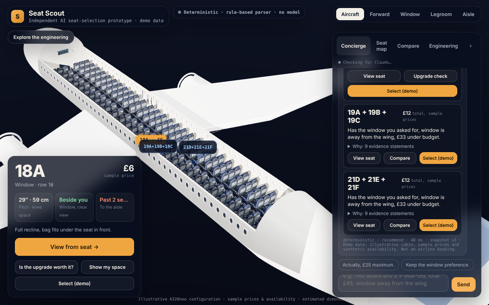
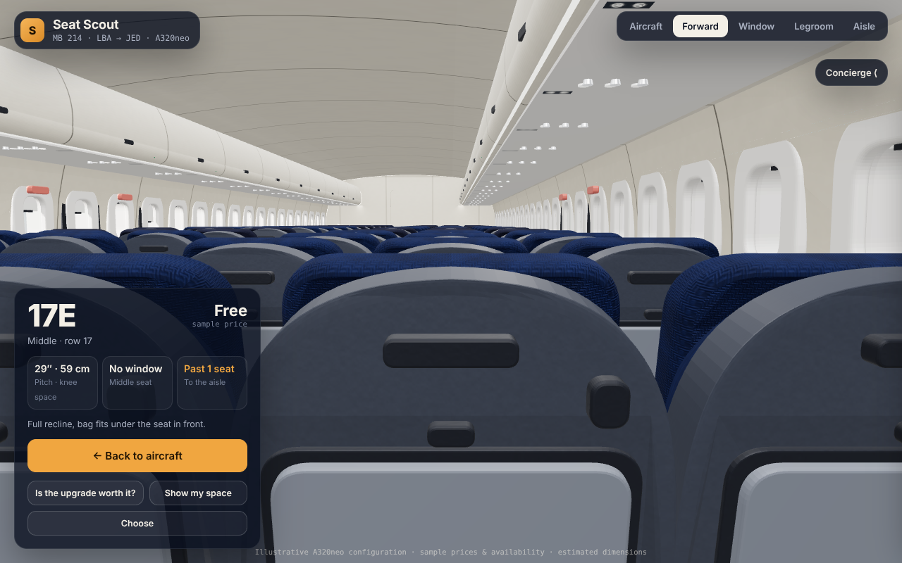
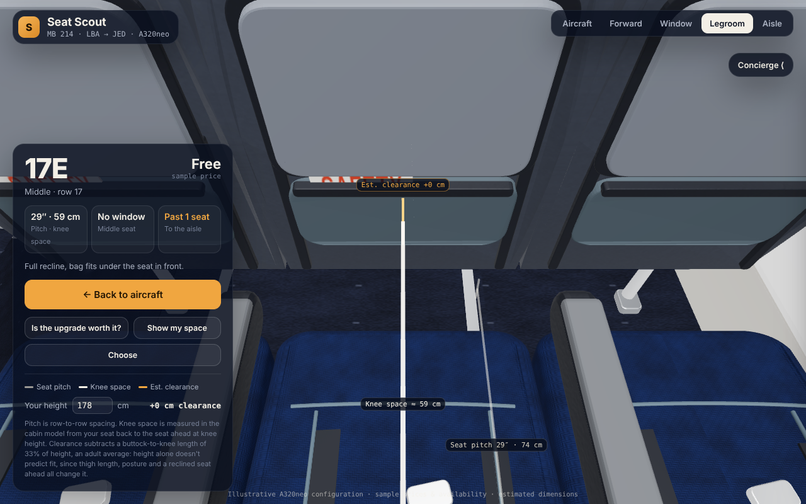
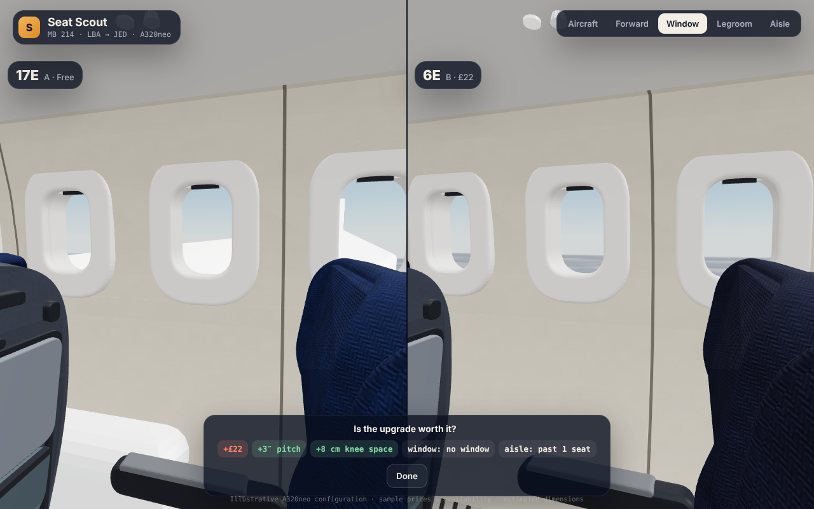
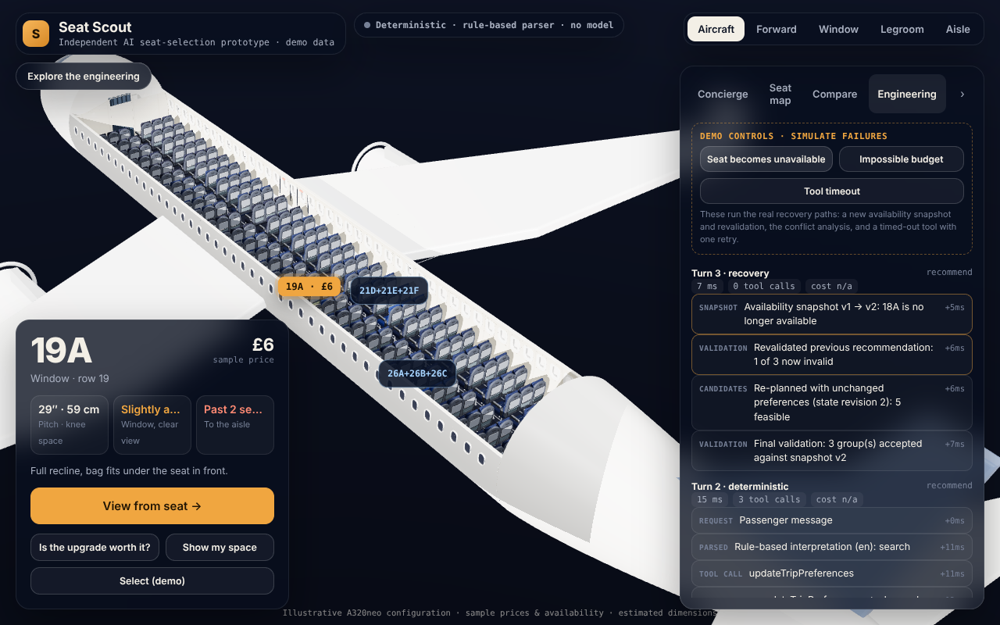

# Seat Scout

**An independent AI seat-selection prototype.** A tool-using agent interprets what passengers want; a deterministic constraint engine decides what's actually allowed; a 3D aircraft cutaway shows the answer, and an execution trace shows why.

> All data is synthetic: an illustrative A320neo-style cabin, sample prices and generated availability. Not affiliated with any airline; nothing is booked.



**Live preview:** [claude.ai artifact](https://claude.ai/artifact/FaweTYWuRkYkGMVkpSTvRa). This is the single-file preview build: the same core and tools in the browser, with Claude reached through the viewer's own claude.ai account when they allow it, or a labelled deterministic mode otherwise. I need to share it publicly before anyone else can open it. The full agent runs server-side from this repository (below).

## Why I built this
I saw a demo of a cinema seat picker and wanted to try a harder, real-world version: plane seats, where the constraints actually matter (budgets, sitting together, rules about children in exit rows, seats disappearing while you decide). It also let me show what I think an AI agent should look like: the model understands people, but code enforces the rules, and you can always ask “why did it choose these seats?” and get a correct, reproducible answer.

## What it does
- Takes a request like *“We're two adults travelling with a five-year-old. Our total seat budget is £45. We want to sit together, and I'd prefer a window away from the wing.”*
- Extracts a structured request, separating **hard constraints** (budget, party, sitting together, demo eligibility policy) from **preferences** (window, away from the wing, legroom…).
- Searches the cabin dataset, enforces availability, budget, adjacency and eligibility **in code**, ranks the feasible groups by named preference scores, and lights them up in the aircraft.
- Explains each option with statements tagged **Fact / Calculated / Preference / Estimate**.
- Handles follow-ups by patching only the fields that changed: “Actually, £25 maximum.”, “Keep the window preference.”, “Why not row 6?”, “Compare that with the cheapest valid option.”, “One person is no longer travelling.”
- Recovers when a recommended seat is taken (new availability snapshot → revalidate → re-plan with the same preferences), explains impossible requests instead of overspending or splitting the group, and retries a timed-out tool.
- Lets you fly from the aircraft into the selected seat's eye position, compare two seats from the same angle, and see pitch, knee space and estimated clearance guides.

| | |
|---|---|
|  |  |
|  |  |

## How it works
See [docs/architecture.md](docs/architecture.md) for the diagram and trust boundaries.

- **One canonical dataset** (`data/`, generated reproducibly by `scripts/generate-data.ts`) feeds the 3D geometry, seat map, tools and cards. Every attribute carries provenance: synthetic, estimated or calculated.
- **Deterministic core** (`src/core/`): group enumeration, hard constraints with explicit exclusion reasons, transparent scoring components, relaxation analysis when nothing fits, an independent validator, and grounded explanations.
- **Agent** (`src/agent/`): one bounded tool-use loop (≤8 steps, model and tool timeouts) with eight zod-validated tools. The model interprets the request and explains the results; it never computes prices, eligibility or adjacency. Every submitted recommendation is re-validated, and cards are built from data, not model text. If the model fails, a rule-based planner (English + Arabic) answers through the same tools, and the answer is labelled as such.
- **State** (`src/core/state.ts`): structured trip preferences persisted separately from the conversation; versioned availability snapshots per session.
- **Server** (`src/server/`): Node HTTP with HttpOnly session cookies, per-session isolation and rate limits, body validation, and the API key kept server-side.
- **Engineering view**: the real execution trace (parsed request, constraints, tool calls with validated arguments, candidates, exclusions, scores, validation, model usage and latency), linked to seats in the 3D scene. It is an application log, not model reasoning.

### Key tradeoffs
- *Model interprets, code decides:* less “creative” flexibility, verifiable correctness.
- *One agent, not many:* predictable latency and failure modes.
- *Structured state over chat history:* follow-ups can't silently drop constraints.
- *Re-validate at the end:* handles seats disappearing mid-conversation.
- *Deterministic fallback:* always answers, with narrower language understanding.
- *Procedural 3D:* lightweight and licence-free, not photoreal.

## Evaluation (actual results)
47 cases in `eval/cases.json`, written before running and checked by `eval/checks.ts` against the raw data files (not the engine). Categories: strict budgets, adjacent groups, window/aisle, unavailable seats, no feasible solution, multi-turn changes, ambiguous requests, eligibility rules, Arabic and English, and override/injection attempts.

**Deterministic run, 2026-10-13** (rule-based parser + tools; no model involved):

| System | Cases passed | Hard constraints | Adjacency & price | Impossible handled | Multi-turn state | Unsupported numeric claims |
|---|---|---|---|---|---|---|
| Tool-grounded deterministic pipeline | 45/47 | 100% | 100% | 4/6 | 100% | 0 |
| Naive baseline (same parser, no constraint engine) | 9/47 | 34% | 36.2% | 0/6 | 100% | 0 |

- The first run scored 39/47 and found real bugs (an unparsed phrase, “Cheaper.” lowering the budget below every option), which I then fixed. See [eval/results/HISTORY.md](eval/results/HISTORY.md).
- The two remaining failures are a genuine product question: a bare “window” is treated as a preference, not a must-have. They are left visible.
- **Live-model evaluation has not been run** (no API key during development). `npm run eval:live` compares the tool-grounded agent with a no-tools baseline using the same model and settings; no live numbers are claimed here.

Tests: `npm test` runs 26 unit and integration tests (engine, parser, tools, agent loop with a scripted test double, recovery, sessions, HTTP). `npm run test:e2e` runs a Playwright test of the full passenger journey.

## Run it locally
Requires Node 20+.
```bash
npm install
npm run dev                  # builds the web bundle and starts http://localhost:8787 (deterministic mode)
ANTHROPIC_API_KEY=... npm start   # live agent, server-side (optional: SEAT_SCOUT_MODEL=claude-sonnet-5-5)
npm test                     # unit + integration
npm run eval                 # deterministic evaluation → eval/results/
npx playwright install chromium && npm run test:e2e
npm run build:artifact       # single-file preview in artifact/
```
Cost per turn is shown only if you fill in current prices in `config/pricing.json`. Nothing is hard-coded.

## Known limitations
- Synthetic data only; the A320neo-style layout is illustrative, and real cabins vary by airline.
- Knee space and window alignment come from a procedural 3D model; noise is a coarse zone label. Height-based clearance uses a population average, and height alone doesn't predict comfort.
- The exit-row rules are an explicit **demo policy** (`data/policy.demo.json`), not any airline's.
- The rule-based fallback handles common English/Arabic phrasings only. Groups larger than three, or split seating, aren't supported.
- No live-model evaluation numbers yet. All 3D assets are procedural.

## AI-assisted development
**I created Seat Scout with AI coding assistance.** I chose the problem; wrote the requirement briefs that set the product direction and quality bar (realism, the aircraft-to-seat camera sequence, grounded tool use, the execution trace, the evaluation suite and failure-recovery demos); and reviewed the renders and results, asking for changes, such as not spending my own AI credits when other people use the preview and making the assistant answer general questions. I used AI (Claude, through Claude Code) to write the code, tests, evaluation suite and documentation, to debug rendering and test failures, and to run the evaluations reported above. I didn't hand-write the generated code. Commits made with AI assistance carry a `Co-Authored-By` trailer.

[docs/demo-script.md](docs/demo-script.md) is a three-minute walkthrough.
