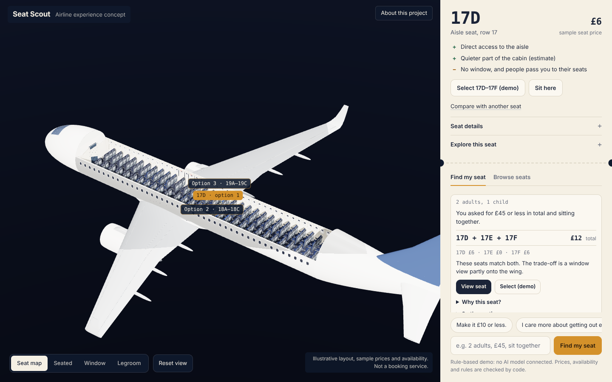
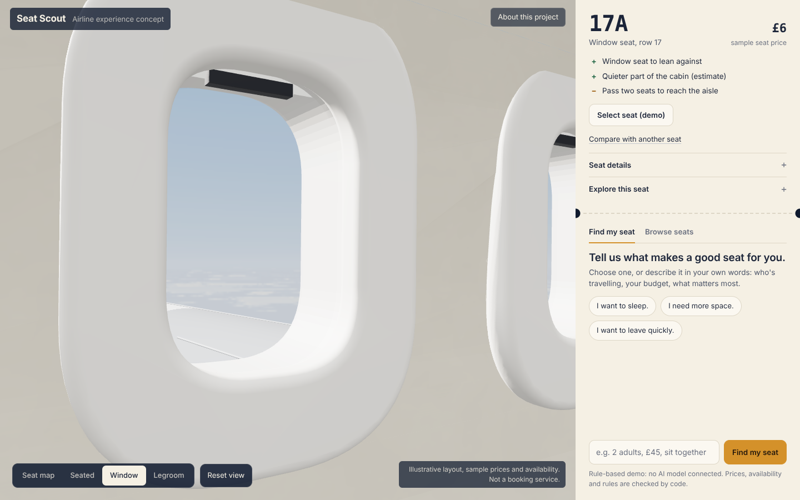
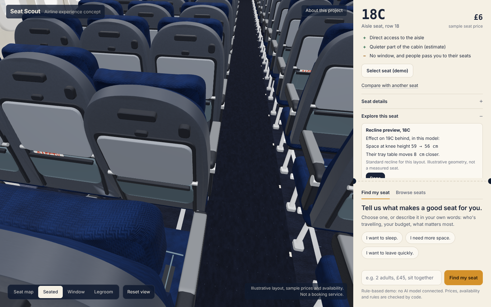
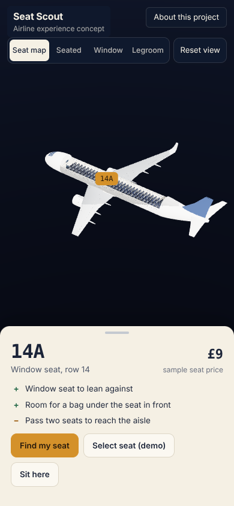
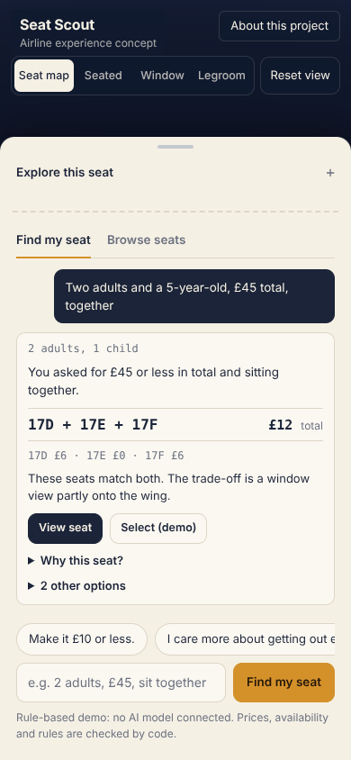

# Seat Scout

**Try your seat before you fly.** A personal prototype exploring AI-assisted seat selection and interactive cabin previews for airline customer service.



> **Please note**
> - This is a personal portfolio prototype, not a real airline service, and it is not affiliated with any airline.
> - The cabin layout, prices and availability are illustrative demo data. The outside view is illustrative too.
> - It does not make bookings or connect to any airline system.

Code: [github.com/Mohammed-890/seat-scout](https://github.com/Mohammed-890/seat-scout).

## The problem
Seat maps show numbers and colours, but passengers want to know what a seat is actually like: how much room there is, whether the window lines up, how hard it is to get out, and what they give up for a lower price. Those questions often end up with customer-service staff. Seat Scout explores answering them before the passenger chooses.

## Run it locally
Requires Node 20+.
```bash
npm install
npm run dev            # builds the page and starts http://localhost:8787 (rule-based demo, no key needed)
```
Optional, for the live AI adviser (the key stays on the server):
```bash
ANTHROPIC_API_KEY=... npm start     # optionally SEAT_SCOUT_MODEL=<model id>
```

## What works today
1. **Find my seat.** Pick *I want to sleep*, *I need more space* or *I want to leave quickly*, or describe your trip in your own words. The adviser answers with one seat (or group) and says why, for example: *"You asked for £45 or less in total and sitting together. These seats match both. The trade-off is a window view partly onto the wing."* Alternatives, with their exact compromise, and a short *Why this seat?* are folded away.
2. **See it from the seat.** Camera presets for the seat map, the seated view, the window view and a legroom view, with *Reset view*. The window view frames the nearest window from a seated eye position.
3. **Read the essentials.** The seat pass shows the seat, its sample price, two advantages and one trade-off, all derived from the seat data. *Seat details* holds the measurements, and keeps seat pitch (row spacing) separate from the modelled space at knee height.
4. **Compare two seats.** Price difference, pitch, knee space, window, aisle access, recline, and the difference that matters for what you asked.
5. **Explore this seat.** Window shade, tray table, reading light and a recline preview that shows the modelled effect on the seat behind.
6. **Select (demo).** The selection is re-checked against current availability, confirmed as a demo (nothing is booked) and can be changed.

If you change your mind ("Actually, £25 maximum."), only that requirement changes, and earlier suggestions are marked outdated and can no longer be selected. If nothing fits, the adviser lists the changes that would give you options and asks which you accept; it never goes over a budget or splits a group on its own. Without WebGL, or if the 3D library fails to load, a 2D seat chart and the adviser keep working.

| | |
|---|---|
|  |  |
|  |  |

Screenshots were rendered with software WebGL in a headless browser. The cabin and scenery are simplified procedural models with a stylised finish, not photorealistic.

---

## How recommendations work
| Part | Uses | What it does |
|---|---|---|
| Understanding the request | **AI** when a model is connected; otherwise a **rule-based parser** (common English and Arabic phrasings) | Turns the message into a structured trip state: travellers, budget, requirements, preferences |
| Prices, availability, sitting together, demo exit-row policy | **Deterministic code** | Hard constraints; a group that misses one is never shown |
| Ranking | **Deterministic code** | Orders valid options by the stated preferences (not a comfort rating) |
| "You asked for … / trade-off" summary, comparisons | **Deterministic code** | Built from the trip state and seat data, never from model text |
| Final check before showing or selecting | **Deterministic code** | Re-validates against the latest availability snapshot |
| Wording of the explanation | **AI** when connected | The model may explain, but cannot change facts, prices or availability |

The app always says which mode it is in: *"Rule-based demo: no AI model connected"* or *"Adviser: Claude (live AI)"*. In the claude.ai preview, the same core runs in the page and Claude is reached through the viewer's own claude.ai account when they allow it; otherwise the rule-based mode answers.

See [docs/architecture.md](docs/architecture.md) for the diagram and trust boundaries.

- **One dataset** (`data/`, generated by `scripts/generate-data.ts`) feeds the 3D cabin, seat chart, tools and cards. Each attribute is marked synthetic, estimated or calculated.
- **Deterministic core** (`src/core/`): group enumeration, hard constraints with exclusion reasons, transparent scoring, relaxation analysis when nothing fits, an independent validator, and the fit summary (`explain.ts`).
- **Agent** (`src/agent/`): one bounded tool-use loop (at most 8 steps, model and tool timeouts) with zod-validated tools.
- **Server** (`src/server/`): Node HTTP with HttpOnly session cookies, rate limits, body validation and the API key kept server-side. Turns stream real trace events; one turn runs at a time per session, and retries reuse a request id so a turn is never applied twice.
- **Front end** (`web/`): `cabin3d.js` (aircraft, instanced cabin, camera presets), `explore.js` (seat controls and recline preview), `scenery.js` (sky and clouds, loaded after the first frame), `flat.js` (2D fallback), `ui.js` (seat pass, adviser, comparison, About).

## Evaluation
47 cases in `eval/cases.json`, checked by `eval/checks.ts` against the raw data files (not the engine): budgets, adjacent groups, window/aisle, unavailable seats, no feasible solution, multi-turn changes, ambiguous requests, eligibility rules, Arabic and English, and override attempts.

**Deterministic run** (rule-based parser + tools; no model involved):

| Metric | Tool-grounded pipeline | Naive baseline (same parser, no constraint engine) |
|---|---|---|
| Cases passed | 47/47 | 9/47 |
| Request understanding (stated requirements recorded) | 27/27 | 27/27 |
| Parsed-constraint satisfaction (shown groups) | 95/95 | 13/47 |
| Actual-requirement satisfaction (shown groups) | 95/95 | 13/47 |
| Impossible requests recognised | 6/6 | 0/6 |
| Adjacency & price correct (shown groups) | 95/95 | 17/47 |
| Multi-turn state (fields) | 16/16 | 16/16 |
| Unsupported numeric claims | 0 | 0 |

An earlier version recommended free middle seats for "1 adult, window, total £2" and the Arabic "alone, window seat, £3", because a bare "window" was stored as a preference. A named seat position is now a requirement unless the clause softens it ("prefer", "ideally", "نفضل"). History: [eval/results/HISTORY.md](eval/results/HISTORY.md).

**Live-model evaluation has not been run** (no API key was available). `npm run eval:live` would compare the tool-grounded agent with a no-tools baseline; no live-model numbers are claimed.

## Tests
```bash
npm test                 # unit + integration
npm run eval             # deterministic evaluation → eval/results/
npm run test:e2e         # Playwright end-to-end (slow with software WebGL)
npm run build:artifact   # single-file preview → artifact/
node scripts/shots.mjs docs/screenshots   # screenshots (dev tool)
```
Latest results: [docs/verification.md](docs/verification.md).

## Known limitations
- Illustrative A320-style layout, sample prices and generated availability. Real cabins vary by airline and aircraft.
- Knee space and window position come from a simplified 3D model; body clearance is an estimate, and height alone doesn't predict comfort. Noise is a coarse zone estimate.
- The exit-row rules are an explicit demo policy (`data/policy.demo.json`), not any airline's.
- The rule-based mode handles common English and Arabic phrasings only. Groups larger than three, or split seating, aren't supported.
- Rendering was only checked with software graphics in a headless container. No frame-rate figure is claimed; render quality drops automatically if frames stay slow.
- Mobile layouts were checked in a 390 × 844 headless viewport, not on physical phones.

## Future improvements
- Real seat maps and fares through an airline's own systems, with its permission.
- A live-model evaluation with the same independent checks.
- Accessibility needs as explicit requirements.
- Testing with real passengers and customer-service staff.

