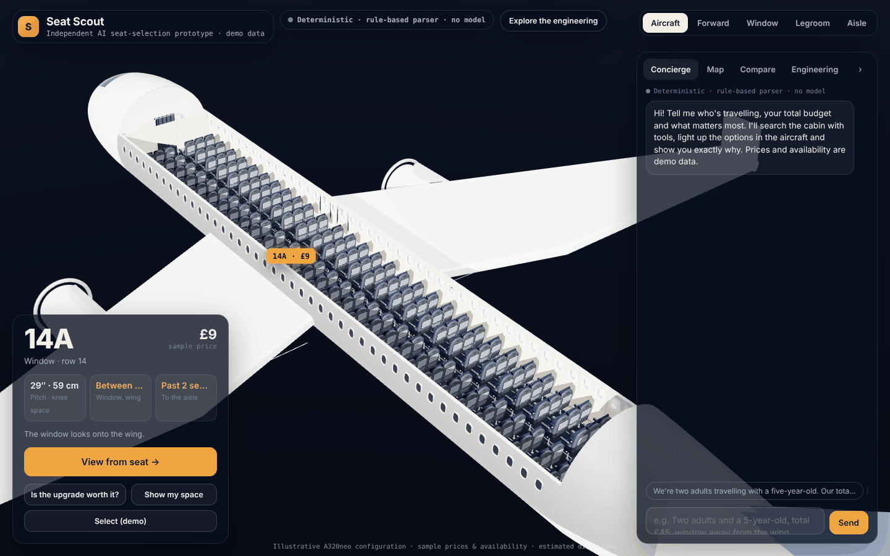
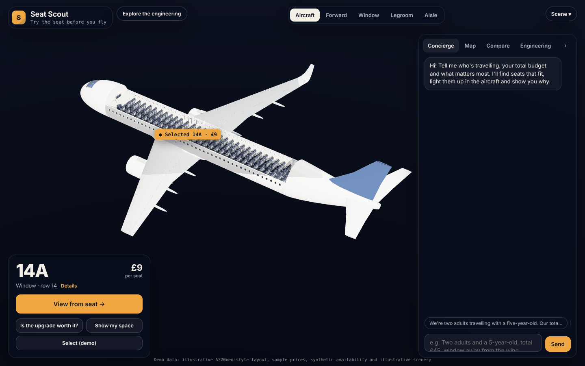
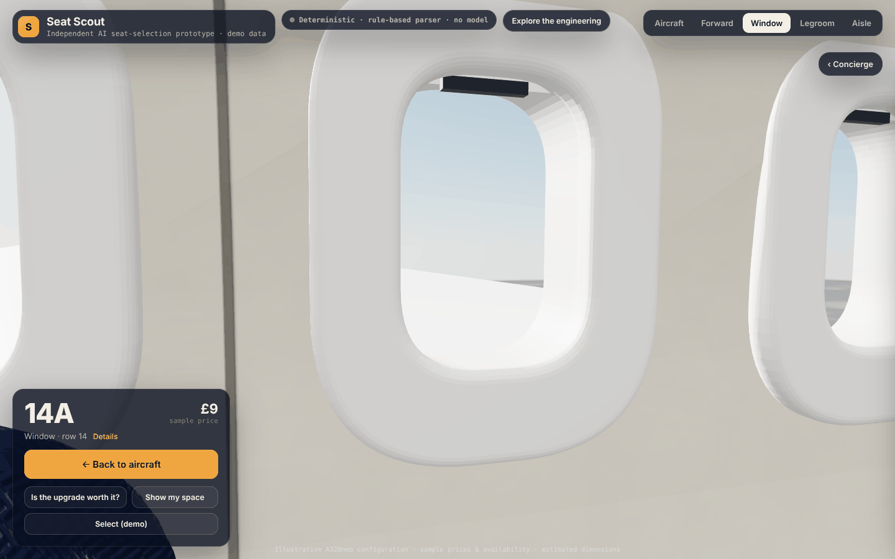
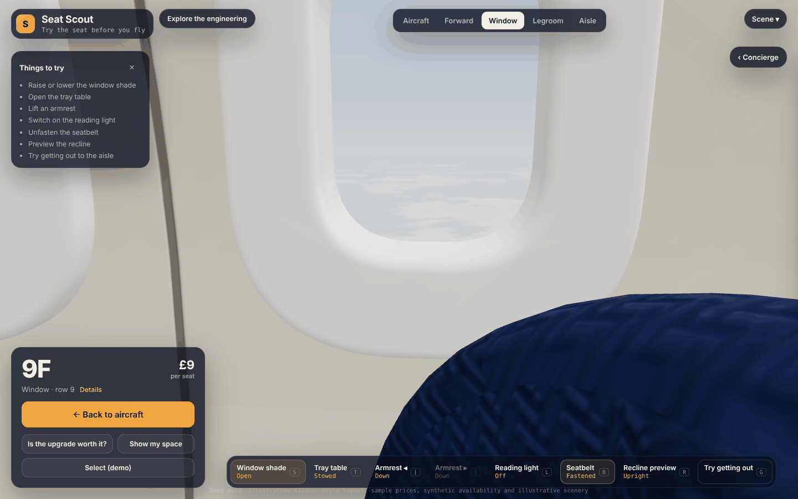
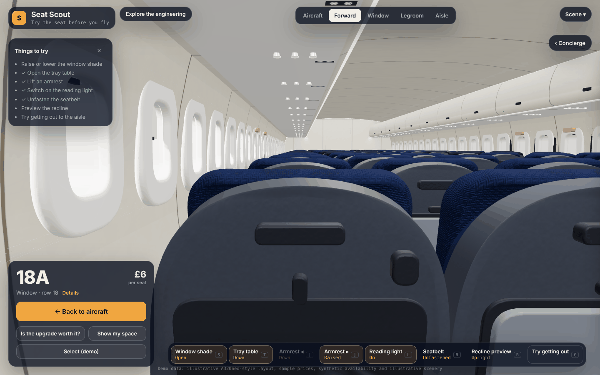
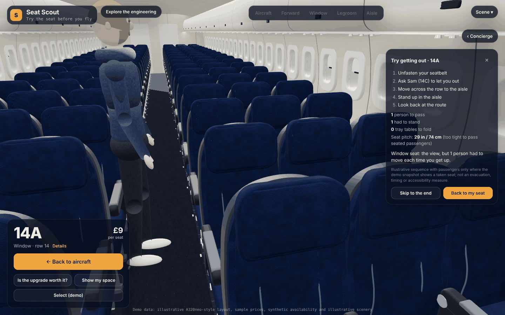
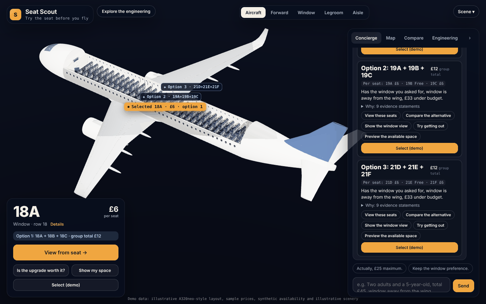
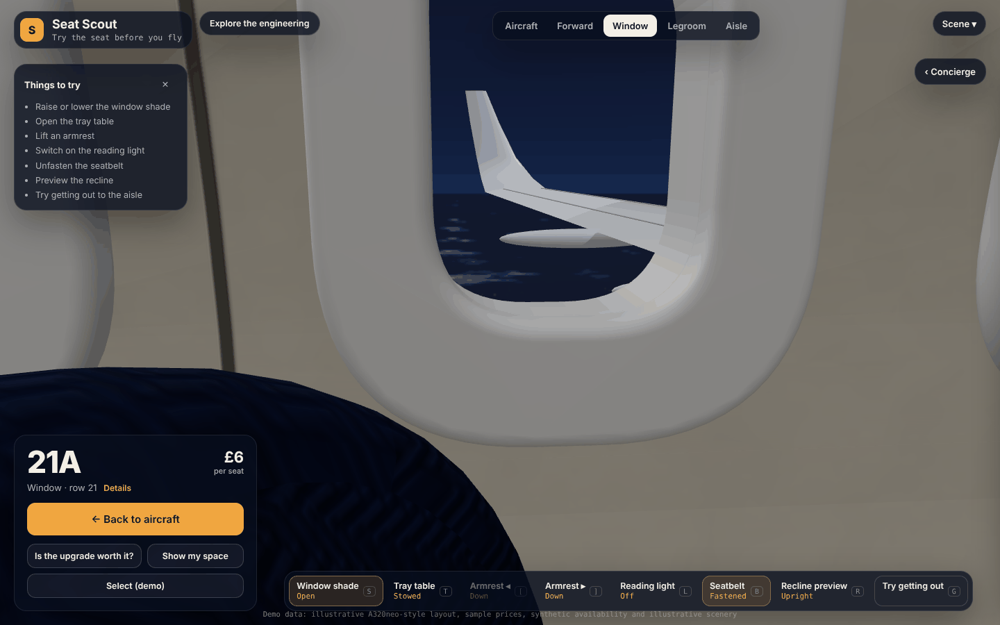

# Seat Scout

**Try the seat before you fly.** An independent AI seat-selection prototype: explore an aircraft, sit in any free seat, use the cabin (tray, shade, armrests, reading light, seatbelt, recline), see the view outside, and ask a tool-using concierge to find seats. A deterministic constraint engine decides what's actually allowed, and an execution trace shows why.

> All data is synthetic: an illustrative A320neo-style cabin, sample prices and generated availability. Not affiliated with any airline; nothing is booked.


**Live preview:** [claude.ai artifact](https://claude.ai/artifact/FaweTYWuRkYkGMVkpSTvRa). This is the single-file preview build: the same core and tools in the browser, with Claude reached through the viewer's own claude.ai account when they allow it, or a labelled deterministic mode otherwise. I need to share it publicly before anyone else can open it. The full agent runs server-side from this repository (below).

## Why I built this
I saw a demo of a cinema seat picker and wanted to try a harder, real-world version: plane seats, where the constraints actually matter (budgets, sitting together, rules about children in exit rows, seats disappearing while you decide). It also let me show what I think an AI agent should look like: the model understands people, but code enforces the rules, and you can always ask “why did it choose these seats?” and get a correct, reproducible answer.

## What it does
**The concierge.** Ask *"We're two adults travelling with a five-year-old. Our total seat budget is £45. We want to sit together, and I'd prefer a window away from the wing."* It separates **requirements** (budget, party, sitting together, demo eligibility policy, any seat position you name) from **preferences** ("prefer a window", "away from the wing"). Budget, availability, adjacency and eligibility are enforced **in code**. The options are lit up in the aircraft and explained with statements tagged Fact / Calculated / Preference / Estimate. Follow-ups patch only the fields that change: "Actually, £25 maximum.", "Keep the window preference.", "Why not row 6?", "I care more about getting out easily.". Each card offers scene actions: *View these seats, Compare the alternative, Show the window view, Try getting out, Preview the available space.*

**The aircraft and cabin.** A cutaway framed to fit the free screen area, with lofted, tapered, swept wings, sharklets, lathe-profiled engines and a cutaway edge. Selecting a seat flies the camera to its seated eye position; going back keeps your orientation. From the seat you can use the cabin objects that seat actually has (row 1 has no seat-back tray; wall and exit-row armrests don't lift), each with a hover/focus cue, an on-screen hotspot, a toolbar button and a keyboard shortcut. The recline preview steps into the aisle behind and shows how much space the passenger behind loses, measured in the model.

**Outside.** Day above the clouds, warm sunset, or clear night with restrained stars and city lights. The presets also set the cabin lighting, and window shades block the sunlight. Clouds drift toward the tail while the wing stays fixed. The scenery is illustrative, not live route imagery.

**Try getting out.** From a window or middle seat, the neighbours between you and the aisle stand into the aisle (aisle side first), or swing their knees aside where the pitch allows. The panel counts the people who moved, the trays folded and the seat pitch, and states the window-vs-aisle tradeoff. It's an illustration, not a timing or accessibility measure.

**Cabin Playground (optional, off by default).** Fictional, stylised passengers: one asleep by the aisle, an armrest hog, someone in headphones who misses your first "Excuse me", someone balancing a coffee. There are cartoon-style reactions to a nudge, a playful shove or a cheek tap, with bounded wobbles and everyone back in place afterwards. Playground never changes availability.

| Before | After |
|---|---|
|  |  |
|  |  |

| | |
|---|---|
|  |  |
|  |  |

## How it works
See [docs/architecture.md](docs/architecture.md) for the diagram and trust boundaries.

- **One canonical dataset** (`data/`, generated reproducibly by `scripts/generate-data.ts`) feeds the 3D geometry, seat map, tools and cards. Every attribute carries provenance: synthetic, estimated or calculated.
- **Deterministic core** (`src/core/`): group enumeration, hard constraints with explicit exclusion reasons, transparent scoring components, relaxation analysis when nothing fits, an independent validator, and grounded explanations.
- **Agent** (`src/agent/`): one bounded tool-use loop (≤8 steps, model and tool timeouts) with eight zod-validated tools. The model interprets the request and explains the results; it never computes prices, eligibility or adjacency. Every submitted recommendation is re-validated, and cards are built from data, not model text. If the model fails, a rule-based planner (English + Arabic) answers through the same tools, and the answer is labelled as such.
- **State** (`src/core/state.ts`): structured trip preferences persisted separately from the conversation; versioned availability snapshots per session.
- **Server** (`src/server/`): Node HTTP with HttpOnly session cookies, per-session isolation and rate limits, body validation, and the API key kept server-side.
- **Engineering view**: the real execution trace (parsed request, constraints, tool calls with validated arguments, candidates, exclusions, scores, validation, model usage and latency), linked to seats in the 3D scene. It is an application log, not model reasoning.

### Key tradeoffs
- *Model interprets, code decides:* less “creative” flexibility, verifiable correctness.
- *One agent, not many:* predictable latency and failure modes.
- *Structured state over chat history:* follow-ups can't silently drop constraints.
- *Re-validate at the end:* handles seats disappearing mid-conversation.
- *Deterministic fallback:* always answers, with narrower language understanding.
- *Procedural 3D:* lightweight and licence-free, not photoreal.

## Evaluation (actual results)
47 cases in `eval/cases.json`, checked by `eval/checks.ts` against the raw data files (not the engine). Categories: strict budgets, adjacent groups, window/aisle, unavailable seats, no feasible solution, multi-turn changes, ambiguous requests, eligibility rules, Arabic and English, and override/injection attempts.

**Deterministic run, 2026-10-14** (rule-based parser + tools; no model involved). Every figure shows its numerator and denominator:

| Metric | Tool-grounded pipeline | Naive baseline (same parser, no constraint engine) |
|---|---|---|
| Cases passed | 47/47 | 9/47 |
| Request understanding (stated requirements recorded) | 27/27 | 27/27 |
| Parsed-constraint satisfaction (shown groups) | 95/95 | 13/47 |
| Actual-requirement satisfaction (shown groups) | 95/95 | 13/47 |
| Impossible requests recognised | 6/6 | 0/6 |
| Adjacency & price correct (shown groups) | 95/95 | 17/47 |
| Multi-turn state (fields) | 16/16 | 16/16 |
| Unsupported numeric claims | 0 | 0 |

**What changed, and why an earlier panel said "100% hard constraints" with two failures.** Cases `nofeas-05` ("1 adult, window, total £2") and `ar-03` (Arabic, "alone, window seat, £3") recommended free middle seats. The parser only made a seat position a requirement when the message said "must" or "need", so a bare "window" was stored as a preference. The old metric checked shown seats against the *recorded* constraints, which those seats did meet. The solver was right about the wrong question. Re-running the old parser against the new checks gives request understanding **20/27**, parsed-constraint satisfaction **101/101**, actual-requirement satisfaction **95/101** and impossible requests **4/6** (`eval/results/2026-10-14-deterministic-before-parser-fix.json`). The fix: a named seat position is a requirement unless its clause softens it ("prefer", "ideally", "نفضل"). The cases were strengthened with an explicit `requires` field; none was loosened. Full history: [eval/results/HISTORY.md](eval/results/HISTORY.md).

**Live-model evaluation has not been run** (no API key during development). `npm run eval:live` compares the tool-grounded agent with a no-tools baseline using the same model and settings; no live numbers are claimed anywhere.

**Tests.** `npm test`: 31 unit and integration tests, covering engine, parser, tools, the agent loop with a scripted test double, recovery, sessions, HTTP, streaming, one-turn-per-session and idempotent retries. `npm run test:e2e`: Playwright end-to-end tests of the passenger journey and the verification list (see *Verification* below).

## Run it locally
Requires Node 20+.
```bash
npm install
npm run dev                  # builds the web bundle and starts http://localhost:8787 (deterministic mode)
ANTHROPIC_API_KEY=... npm start   # live agent, server-side (optional: SEAT_SCOUT_MODEL=claude-sonnet-5-5)
npm test                     # unit + integration
npm run eval                 # deterministic evaluation → eval/results/
npx playwright install chromium && npm run test:e2e
npm run build:artifact       # single-file preview in artifact/
```
Cost per turn is shown only if you fill in current prices in `config/pricing.json`. Nothing is hard-coded.

## Known limitations
- Synthetic data only; the A320neo-style layout is illustrative, and real cabins vary by airline. Scenery is illustrative.
- All 3D assets are procedural. There are no licensed cabin or human models, so the Playground passengers are **stylised** clay-like figures with keyframed poses, not realistic people or motion-captured animation. Their bounded reactions are tested; their animation quality is limited.
- Movement paths avoid geometry by construction (aisle-side passengers swivel into the aisle; inner passengers slide over first). There is no general collision system.
- Knee space, recline effects and window alignment come from the 3D model; noise is a coarse zone label. Body clearance uses a population average, and height alone doesn't predict comfort.
- The exit-row rules are an explicit **demo policy** (`data/policy.demo.json`), not any airline's.
- The rule-based fallback handles common English/Arabic phrasings only. Groups larger than three, or split seating, aren't supported.
- Performance was only measured with software WebGL (SwiftShader) in a headless container, where a full-screen cabin frame takes seconds. No frame-rate figure for real GPUs is claimed. The app records frame times in the browser (Engineering → Performance) and offers a Low quality mode.
- Mobile keyboard handling uses `visualViewport`; it was checked in a mobile-sized headless browser (the composer stays inside the viewport when focused), not on physical phones.
- No live-model evaluation numbers yet.

## AI-assisted development
**I created Seat Scout with AI coding assistance.** I chose the problem; wrote the requirement briefs that set the product direction and quality bar (realism, the aircraft-to-seat camera sequence, grounded tool use, the execution trace, the evaluation suite, failure-recovery demos, and in this iteration the correctness fix, interactive cabin, scenery, Playground and aisle-access demo); and reviewed the renders and results, asking for changes, such as not spending my own AI credits when other people use the preview and making the assistant answer general questions. I used AI (Claude, through Claude Code) to write the code, tests, evaluation suite and documentation, to debug rendering and test failures, and to run the evaluations reported above. I didn't hand-write the generated code. Commits made with AI assistance carry a `Co-Authored-By` trailer.

[docs/demo-script.md](docs/demo-script.md) is a three-minute walkthrough.
