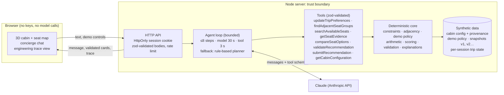

# Architecture and trust boundaries

## Request flow (one turn)
1. **Request**: the passenger message arrives with the session's state revision and availability snapshot version.
2. **Interpretation**: Claude reads the message plus the *structured* trip state (not the whole raw chat) and calls `updateTripPreferences` with only the changed fields. In no-key mode, the rule-based parser produces the same patch.
3. **Search**: `findAdjacentSeatGroups` enumerates every side-by-side group of the right size, applies hard constraints (availability, total or per-seat budget, demo eligibility policy, must-haves) with explicit exclusion reasons, and ranks the rest by named preference components. If nothing fits, it returns a relaxation analysis.
4. **Validation**: the model validates its picks and then submits. The application **re-validates** everything against the latest snapshot, recomputes totals and builds the cards from the dataset. Invalid picks are dropped and the turn says so; after two rejected submissions it falls back to the deterministic planner.
5. **Trace**: every step is recorded as an application event (the arguments, results, exclusions, scores, validation, model usage and latency), not hidden reasoning.

## Trust boundaries
| Boundary | What is protected | How |
|---|---|---|
| Client ↔ server | API key, other sessions | Key only in the server environment; trace values whose keys look like keys or tokens are redacted; random 128-bit HttpOnly SameSite cookie; per-session state and availability |
| Model ↔ business rules | Prices, eligibility, adjacency, availability | The model never computes them: tools do, and the app re-validates every proposal |
| Untrusted text ↔ instructions | Prompt injection via user or retrieved text | Passenger tips are returned as `{untrusted: true}` data; the system prompt says not to follow them; the user can't change the demo policy; evaluated in the `override_attempt` cases |
| Input ↔ state | Malformed or hostile input | zod schemas on every tool input and request body (`strict`, bounded sizes); invalid input becomes a tool error, not a state change |
| Snapshot ↔ selection | Stale recommendations | Versioned snapshots; selection and recovery always revalidate against the latest version |

## Preview deployment (claude.ai artifact)
The single-file preview bundles the same core, tools and UI into the page. When the viewer allows it, Claude is reached through the artifact `sample` capability **on the viewer's own claude.ai account**: there is still no key in the page, and tools run in the page with the same validation. Token counts aren't exposed there, so the trace shows latency only. Otherwise the preview uses the deterministic planner and says so.
